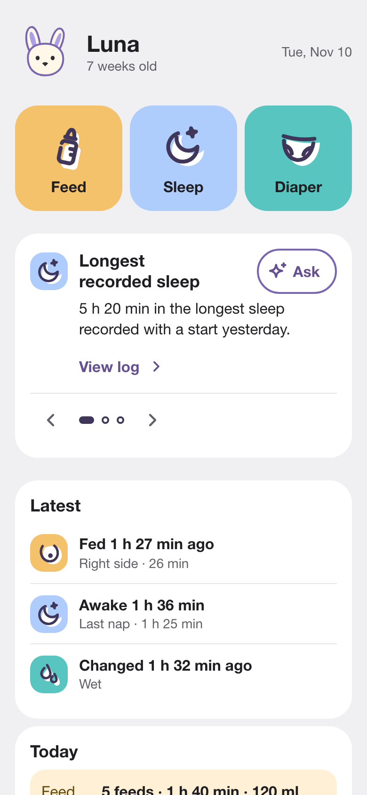
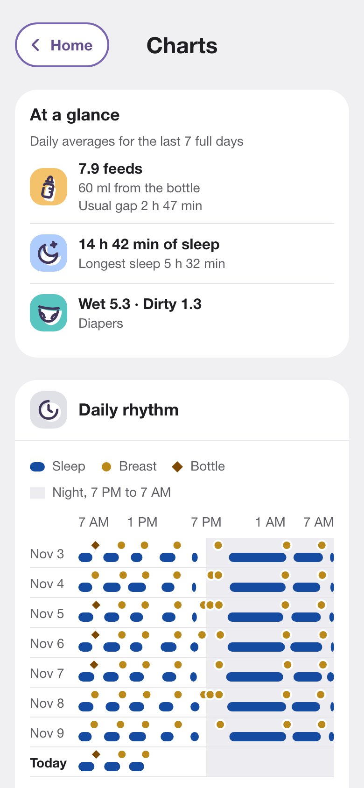
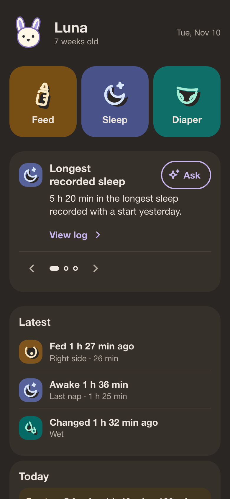

# Little Days

A baby tracker I built for my family. It is made for a tired parent with one free hand.

**Status: my family uses it every day. An open source edition is in progress.**

The screenshots show a made-up baby and made-up records.

## What it does

- **Log from the Home screen.** Feed, Sleep and Diaper each have one large card. A feed, a sleep or a pump session can run on a timer.
- **See the day.** The Timeline shows each record, the adult who logged it, and the totals for the day.
- **See the week.** The Charts show seven-day averages and a daily rhythm of sleep and feeds.
- **Use it at night.** The night look keeps the screen dark and the text easy to read.
- **Keep more than the basics.** Notes, medicine, growth measurements, photos, appointments and doctor visit records.
- **Read it in English or Spanish.**
- **Keep the records at home.** The app runs on a computer in the house. [Baby Buddy](https://github.com/babybuddy/babybuddy) stores the records.

The app does not give medical advice.

## Open source

The code is not in this repository yet. I am preparing a copy with no family data that you can install on your own computer with Docker. It will go here when it is ready.
