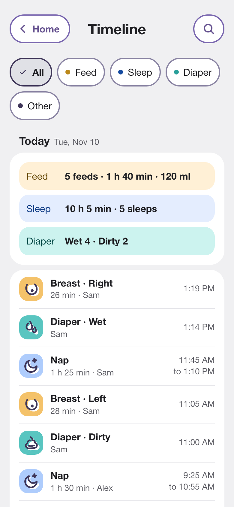

# Little Days

Little Days is a self-hosted baby care tracker. It logs feeds, sleep and diapers from a phone, and it shows the day and the week at a glance. It is a web app that runs on a computer at home and stores its records in [Baby Buddy](https://github.com/babybuddy/babybuddy).

The screenshots show sample data.

## Features

- Feed, sleep and diaper logging from one Home screen
- Timers for feeds, sleep and pumping
- A timeline of each day, with totals and the adult who logged each record
- Charts with seven-day averages and a daily rhythm of sleep and feeds
- Notes, medicine, growth measurements, photos, appointments and doctor visit records
- A night theme
- English and Spanish

## How it is built

- **Web app:** plain JavaScript, HTML and CSS, with no build step
- **Server:** a Node.js gateway written in TypeScript
- **Storage:** [Baby Buddy](https://github.com/babybuddy/babybuddy), an open source baby tracker (BSD 2-Clause license). Little Days runs it unchanged and adds a phone-first app on top.
- **Deployment:** Docker Compose on a home computer

## Status

This repository holds screenshots only. The source code is not published.

Little Days does not give medical advice.
