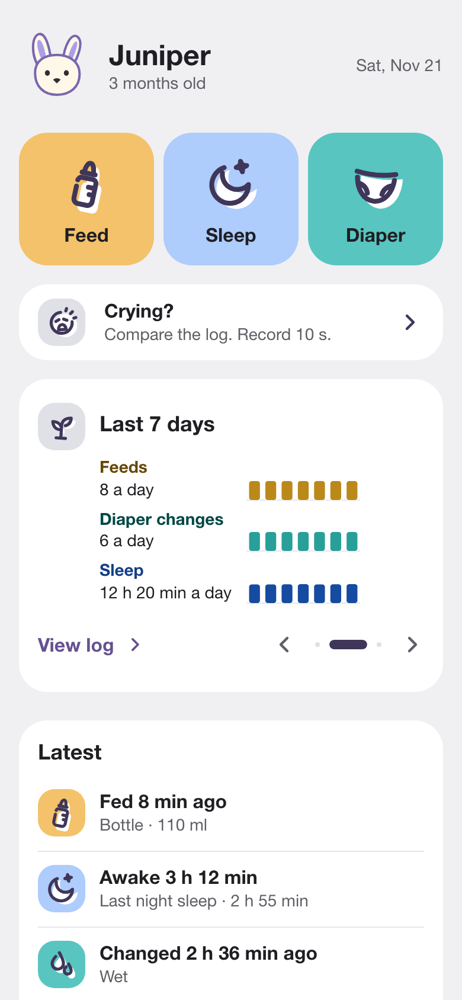
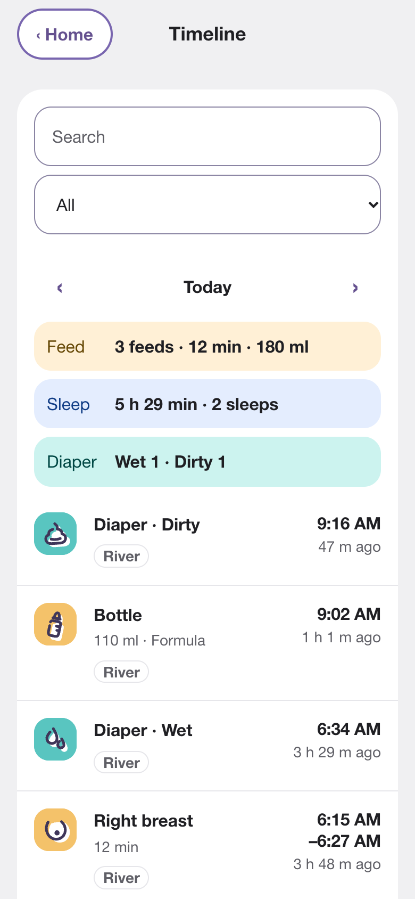
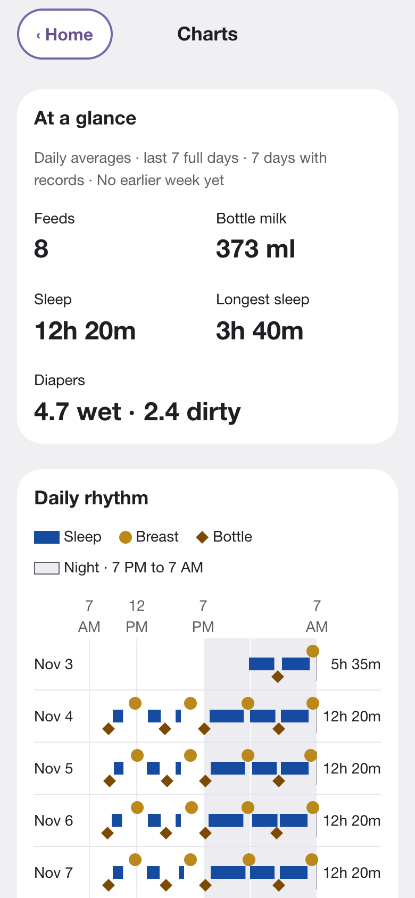
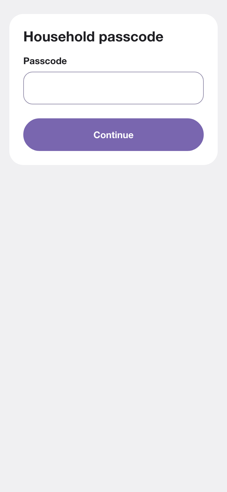

# Little Days

A private baby care log for feeds, sleep and diapers. It runs on your own computer, so the records stay with you. Adults in one household sign in on their phones with a shared passcode. Little Days adds a phone-first app on top of [Baby Buddy](https://github.com/babybuddy/babybuddy), which stores the records.

<p>




</p>

The screenshots show a made-up baby and made-up records.

## What you need

- A computer that stays on: macOS, Linux, or Windows with WSL.
- [Docker](https://docs.docker.com/get-docker/) with the `docker compose` command.
- Python 3.10 or newer (`python3 --version`).
- About 1.5 GB of disk space and 30 minutes.

## Install

```sh
git clone <REPOSITORY URL> little-days
cd little-days
python3 install.py
```

The script asks 6 things, then builds and starts everything:

| Question | What to type |
| --- | --- |
| App address | Press Enter for `https://localhost`. See [HTTPS](#https) for other devices. |
| Time zone | A name such as `America/Chicago`. Press Enter to use your computer's zone. |
| Each adult | A sign-in name, a role (`owner` or `caregiver`), and an optional name to show on screens. At least one adult must be an owner. A caregiver sees fewer records. |
| Household passcode | 10 or more characters. Every adult types it once on each phone. |
| Child's first name | Shown on the Home screen. |
| Child's birth date | `YYYY-MM-DD`. |

Then it runs these steps in order. It stops at the first failure and tells you which step failed.

1. Start Baby Buddy and wait for its first set-up.
2. Disable Baby Buddy's default administrator account, and check that its default password no longer works.
3. Create one Baby Buddy account for each adult, with a long random password that only the app uses. Owners may stop and switch timers; caregivers may not.
4. Set the household passcode.
5. Run two checks that the app needs before it can save measurements: a unit round trip and a CSV export check. They use a temporary test child, which the script removes and confirms.
6. Save the household settings.
7. Start the app and the HTTPS proxy.
8. Add your child.

A run with the images already downloaded took 34 seconds on a laptop. The first run also downloads three images, about 1 GB on disk.

## Open the app and log a feed

1. Open `https://localhost` in a browser on the same computer. The browser warns about the certificate until you trust it: see [HTTPS](#https).
2. Type the household passcode, then choose your name.
3. On the Home screen, tap the Feed card, choose Bottle, choose Breast milk or Formula, and tap Save.

The new feed appears at the top of the Timeline.

## HTTPS

The app refuses to start without an `https://` address, because the session cookie must be secure. The Compose file runs [Caddy](https://caddyserver.com/) in front of the app to make the certificate.

**On this computer (tested).** The address `https://localhost` works as installed. Caddy makes its own certificate authority. To make your browser trust it, copy its root certificate out and add it to your system's trusted certificates:

```sh
docker compose cp caddy:/data/caddy/pki/authorities/local/root.crt caddy-root.crt
```

With that file you can check the HTTPS path: `curl --cacert caddy-root.crt https://localhost/api/health` prints `{"status":"ok"}`.

**On phones in your home (not tested here).** Answer the install question with a host name or address your phones can reach, change `LITTLE_DAYS_BIND=127.0.0.1` to `LITTLE_DAYS_BIND=0.0.0.0` in `.env`, run `docker compose up -d`, and install `caddy-root.crt` on each phone.

**On the internet (not tested here).** Use a host name you own, point its DNS at this computer, open port 443, and answer the install question with `https://your.host.name`. Caddy then gets a Let's Encrypt certificate by itself.

If you use another port in the address (`https://localhost:8443`), the install writes it to `.env` and Compose publishes that port.

## Try it with made-up records

To see the app with a week of invented records, install with the sample answers and load the sample:

```sh
python3 install.py < sample/answers.txt
echo "sample-passcode-2026" | python3 sample/load_sample.py --origin https://localhost:8443 --username river --cafile caddy-root.crt
```

Copy `caddy-root.crt` first (see [HTTPS](#https)). Use the sample only on a throwaway install: it adds about 150 records.

## Everyday use

| Task | Command |
| --- | --- |
| Stop the app | `docker compose stop` |
| Start it again | `docker compose up -d` |
| Reset the passcode (ends every sign-in) | `./reset-passcode.sh` |
| Back up | `docker compose stop`, then copy the `data/` folder and `.env` somewhere private, then `docker compose up -d` |
| Update | `git pull`, `docker compose build gateway`, `docker compose up -d` |
| Start over | `docker compose down -v`, then delete `.env` and `data/` |

`data/` holds every record and every Baby Buddy password. Keep it private.

## Ask AI (on when you add your own key)

AI uses your own API key and your own credits. Until you add a key, the app has no daily development cards and no Chat, and it makes no call to any AI provider. The one exception is an OpenAI-compatible server on the same computer (`localhost`), which needs no key. Add the settings to `.env` and run `docker compose up -d`.

Anthropic (the default provider):

```
LITTLE_DAYS_AI_API_KEY=<your Anthropic key>
```

The model is `claude-haiku-5-5` unless you set `LITTLE_DAYS_AI_MODEL`. An older `.env` with `LITTLE_DAYS_ANTHROPIC_API_KEY` still works.

Any OpenAI-compatible API (OpenAI, OpenRouter, Gemini, Ollama, LM Studio):

```
LITTLE_DAYS_AI_PROVIDER=openai
LITTLE_DAYS_AI_BASE_URL=https://api.openai.com/v1
LITTLE_DAYS_AI_MODEL=<model name>
LITTLE_DAYS_AI_API_KEY=<your key>
```

For OpenRouter, set `LITTLE_DAYS_AI_BASE_URL=https://openrouter.ai/api/v1`. For Ollama on the same computer, set `LITTLE_DAYS_AI_BASE_URL=http://localhost:11434/v1` and leave out the key. With this provider you must set the model, and the model must support structured outputs (`json_schema`). Model names such as `openai/gpt-4o-mini` are accepted. A key can be left out only for `localhost`, `127.0.0.1` or `::1`. Inside Docker, `localhost` is the gateway container, so a server on the host needs its own address and a key.

Daily development cards need Anthropic web search. With the `openai` provider, Chat works and the daily development cards stay off.

To keep AI off with a key in `.env`, add `LITTLE_DAYS_AI_ENABLED=false`.

Upgrading from a version where AI was off by default: if your `.env` has a key, AI turns on after the upgrade and uses your credits, unless `.env` says `LITTLE_DAYS_AI_ENABLED=false`. An empty `LITTLE_DAYS_AI_ENABLED=` line no longer keeps it off. To keep AI off, set `LITTLE_DAYS_AI_ENABLED=false` before you upgrade.

The app reads only the `LITTLE_DAYS_AI_*` settings and `LITTLE_DAYS_ANTHROPIC_API_KEY`. A standard `ANTHROPIC_API_KEY` or `OPENAI_API_KEY` in your shell is never used. Questions and the last seven days of records go to the provider you choose, so read its data terms first. The whole install may ask 20 questions a day. To show or change that limit (0 means no limit):

```sh
docker compose exec -T gateway node server/ai-limit.ts
docker compose exec -T gateway node server/ai-limit.ts 30
```

Chat shows a short medical notice. The app does not give medical advice.

## If something goes wrong

- **"This folder already has an install."** The script will not overwrite one. Use "Start over" above.
- **Stopped at step N.** Read the last lines it printed. Fix that cause, use "Start over", and run `python3 install.py` again. Nothing after the failed step ran.
- **Port already in use.** Choose another port in the address, such as `https://localhost:8443`.
- **Locked out of the passcode screen.** Wait 15 minutes, or run `./reset-passcode.sh`.

## Develop

```sh
cd runtime && npm test              # server tests, Node 24 or newer
python3 -m unittest discover -s deploy -p "test*.py"   # install and Baby Buddy script tests
```

The app is in `runtime/` (a Node gateway in `server/`, the phone app in `web/`). `deploy/` holds the scripts that run inside Baby Buddy. `install.py` runs them in order.

## License

MIT, see [LICENSE](LICENSE). Third-party notices are in [NOTICE](NOTICE). Report a security problem as [SECURITY.md](SECURITY.md) describes.
