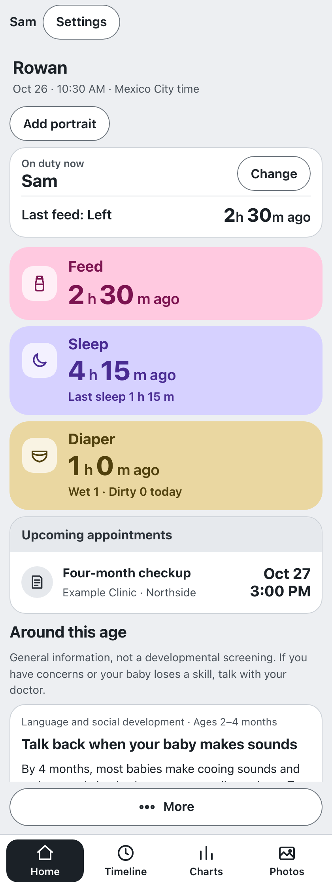
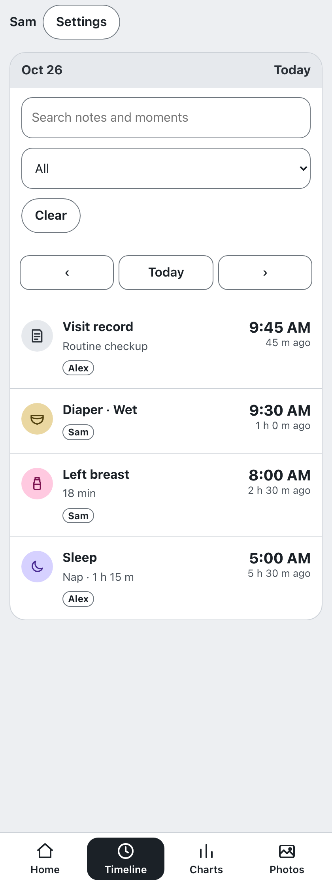

# Little Days

A baby tracker I’m designing for my family.

**Status: in development.** The setup conflict is resolved. Physical-phone checks and a full Mac mini restart remain.

Adults choose their name from a list. The app supports feeds, sleep, diapers, notes, timeline edits, handoff notes, care confirmations, pediatrician appointments, and structured visit records.

Seven-day charts show recorded care patterns. English and Spanish developmental cards use CDC, AAP, and AASM sources. They provide general information, not a developmental screening.

The app does not send reminders and does not monitor crying.

Screenshots use invented sample data. The app and family data are private.
